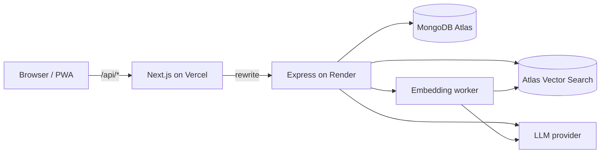

# Architecture: TaskSight

## 1. Stack

| Layer | Choice |
|---|---|
| Web | Next.js 16 (App Router), TypeScript, Tailwind, shadcn/ui, Framer Motion, TanStack Query, dnd-kit |
| API | Express 5, TypeScript, Mongoose, Zod, Pino + pino-http, helmet, express-rate-limit |
| Auth | Access JWT (15 min, `jose`) and a rotating refresh token in an httpOnly cookie, plus RBAC |
| Database | MongoDB Atlas M0 with Atlas Vector Search |
| LLM | Provider-agnostic `llm/` module. Gemini Flash Lite as the default model, Gemini Embedding 2 at 768 dimensions |
| Jobs | In-process queue for embeddings |
| Quality | Vitest, Supertest, mongodb-memory-server, GitHub Actions |
| Hosting | Vercel (web), Render free tier (API) |

The API is separate from Next.js to support long jobs, streaming and a future mobile client.

## 2. Repo layout (pnpm monorepo)
```
TaskSight/
  apps/
    api/        Express (Lane A)
      src/
        config/env.ts       Zod-validated env
        errors/             AppError, central handler
        routes/ modules/    feature modules
        middleware/         requireAuth, rbac, validate, limiters
        db/                 connection, models
        llm/                provider interface, limiter, cache, prompts
        app.ts              builds the app (no listen)
        server.ts           listens, graceful shutdown
    web/        Next.js (Lane B)
  packages/
    shared/     Zod schemas and types used by api and web
  evals/        cases.jsonl, fixtures/, run.ts, results/
  docs/         prd, architecture, design, rule, task, memory
```

`@tasksight/shared` exports raw TypeScript (`exports: "./src/index.ts"`):
- The API runs it with `tsx` in development.
- The web app lists it in `transpilePackages`.
- The API production build uses `tsup` with `noExternal: ["@tasksight/shared"]`, because `tsc` cannot compile a package outside the API `rootDir`.
- `shared` is isomorphic: no Node built-ins, no Mongoose, no server-only imports.

## 3. Same-origin API
The browser calls `/api/*` on the web origin. Next.js rewrites it to the API.



- Rewrite: `/api/:path*` to `${API_ORIGIN}/:path*`. In development `API_ORIGIN` is `http://localhost:4000`, so dev and prod behave the same.
- The API serves `/auth/*` and `/health` at its own root. Only the browser-facing prefix is `/api`.
- Reason: Safari and Firefox block third-party cookies, so a `SameSite=None` refresh cookie between `*.vercel.app` and `*.onrender.com` is unreliable. With the rewrite the cookie is first-party and can be `SameSite=Lax`.
- API responses send `Cache-Control: no-store`. If Vercel still caches a rewritten response, also send `Vercel-CDN-Cache-Control: no-store`.
- Optional hardening: Vercel adds an `x-origin-secret` header and the API rejects requests without it, so the public Render URL cannot be used directly.
- CORS is an origin allowlist from env, mainly for local tools.
- `TRUST_PROXY_HOPS` env sets Express `trust proxy` to an exact hop count (never `true`). Behind Vercel and Render it is probably 2. Verify at deploy by logging `req.ip` and `x-forwarded-for`.
- Streaming (SSE) through the rewrite needs a spike: no buffering and no early idle timeout. Fallback: stream directly from the API origin with the bearer token, for streaming endpoints only.

## 4. Auth
- **Access token:** 15 minutes, held in memory on the client, never in localStorage.
- **Refresh token:** random 256-bit value stored as a sha256 hash with a family id, rotated on every refresh. The record keeps `previousTokenHash` and `previousUsedAt`. Lifetime comes from `REFRESH_TOKEN_TTL_DAYS` (default 14).
- **Cookie:** `refreshToken`, `HttpOnly`, `SameSite=Lax`, `Secure` in production, `Path=/api/auth`.
- **Grace window:** `REFRESH_GRACE_SECONDS` (default 10). Only hashes are stored, so an old token cannot be re-issued. If the presented token is the previous one and was rotated within the window, rotate again in the same family and set a fresh cookie. Otherwise treat it as reuse: revoke the family and return 401. The window is measured between server-side rotation times, so a cold start that delays queued requests does not break it.
- **Passwords:** Argon2id via `@node-rs/argon2` with explicit parameters (`memoryCost` 19456 KiB, `timeCost` 2, `parallelism` 1). `node-argon2` defaults to 64 MiB per hash, too much for a 512 MB container. A semaphore caps concurrent hashes at 2. Verification dispatches on the hash prefix (`$argon2id$`, `$2a$`, `$2b$`) so another algorithm can be added later. Refresh tokens are never hashed with Argon2.
- **Client refresh (single-flight):**
  - Trigger: a 401 with `code: "UNAUTHORIZED"` on a protected endpoint.
  - One refresh at a time; later 401s attach to the same promise.
  - A 401 from `/auth/refresh`, `/auth/login` or `/auth/register` never triggers a refresh.
  - On success, replay each queued request once. A second 401 redirects to `/login`.
  - On failure (401, 403 or network): clear the token, drop the queue, clear the TanStack Query cache, redirect to `/login`.
  - After the app loads, call `GET /api/health` before the first refresh to wake the API; show the wake screen if it is slow.
  - Scope is per tab. The server grace window covers simultaneous tabs.

## 5. API contract
Paths are the API's own. The browser uses the same paths behind `/api`.

| Endpoint | Request | Success | Failure |
|---|---|---|---|
| `GET /health` | none | 200 `{status:"ok", uptime, version}`. `version` comes from `APP_VERSION` (default `"0.0.0"`). Exempt from rate limiting | n/a |
| `POST /auth/register` | `{name, email, password}` (password 8 to 128 chars) | 201 `{accessToken, user:{id,name,email}}` plus refresh cookie | 400, 409 email exists, 429 |
| `POST /auth/login` | `{email, password}` | 200 same body plus cookie | 401 invalid credentials, 429 |
| `POST /auth/refresh` | cookie only | 200 `{accessToken, user}`, cookie rotated | 401 invalid, or reused outside the grace window |
| `POST /auth/logout` | cookie | 204, cookie cleared | n/a |
| `GET /auth/me` | `Authorization: Bearer` | 200 `{user}` | 401 |
| `GET /workspaces` | `Authorization: Bearer` | 200 `{workspaces:[{id,name,ownerId}]}` | 401 |
| `POST /workspaces` | `{name}` + Bearer | 201 `{workspace:{id,name,ownerId}}` | 400, 401 |
| `GET /workspaces/:workspaceId` | Bearer, any role | 200 `{workspace, members:[{userId,role,name,email}]}` | 401, 403, 404 |
| `POST /workspaces/:workspaceId/members` | `{email, role}` + Bearer, owner | 204 | 400, 401, 403, 404, 409 |
| `PATCH /workspaces/:workspaceId/members/:userId` | `{role}` + Bearer, owner | 204 | 400, 401, 403, 404 |
| `DELETE /workspaces/:workspaceId/members/:userId` | Bearer, owner | 204 | 401, 403, 404 |
| `DELETE /workspaces/:workspaceId/leave` | Bearer, any role | 204 | 401, 403, 404 |
| `GET /workspaces/:workspaceId/tasks` | Bearer, viewer+; query: status, priority, assigneeId, label, dueFrom, dueTo, sort, limit(1-100), cursor | 200 `{items:[Task], nextCursor}` | 400, 401, 403, 404 |
| `POST /workspaces/:workspaceId/tasks` | `{title, ...}` + Bearer, member+ | 201 `{task}` | 400, 401, 403 |
| `GET /workspaces/:workspaceId/tasks/:taskId` | Bearer, viewer+ | 200 `{task}` | 401, 403, 404 |
| `PATCH /workspaces/:workspaceId/tasks/:taskId` | partial + Bearer, member+ | 200 `{task}` | 400, 401, 403, 404 |
| `DELETE /workspaces/:workspaceId/tasks/:taskId` | Bearer, member+ | 204 | 401, 403, 404 |

- **Error shape:** `{ error: { code, message, details? } }`, with `details` as `Array<{ path: string, message: string }>` or omitted.
- **Codes:** `VALIDATION_ERROR` 400, `UNAUTHORIZED` 401, `FORBIDDEN` 403, `NOT_FOUND` 404, `CONFLICT` 409, `RATE_LIMITED` 429, `INTERNAL` 500.
- **User shape:** `{ id, name, email }`. A Mongoose `toJSON` transform maps `_id` to `id` and drops `passwordHash` and `refreshTokens`.
- **Workspace shape:** `{ id, name, ownerId }`. `ownerId` is the User id string. `toJSON` maps `_id` → `id`.
- **Workspace member shape:** `{ userId, role, name, email }`. `role` ∈ `owner | member | viewer`. `name` and `email` are joined from User.
- **Roles:** `owner > member > viewer`. `requireRole(min)` allows `role >= min`. The last owner cannot demote themselves or leave (returns `FORBIDDEN`).
- **Task shape:** `{ id, workspaceId, title, description, status, priority, dueDate, labels[], assigneeId, subtasks[], createdBy, version, embeddingStatus, createdAt, updatedAt }`. `status` ∈ `todo | in_progress | done`; `priority` ∈ `low | medium | high`; `dueDate` and `assigneeId` nullable; `subtasks` capped at 30.
- **Task pagination:** cursor is base64url JSON `{v, i}` where `v` is the sort value (createdAt or dueDate with null-sentinel) and `i` is the `_id` tiebreak. Sort is 2-key (`sortVal`, `_id`) so pages never duplicate or skip. `null` dueDate sorts last in both directions.
- Later endpoints: tasks (filters, sorting, cursor pagination), `POST /ai/parse-task`, `/ai/subtasks`, `/ai/ask` (streaming), `/ai/agent/propose`, `/ai/agent/approve`, and an AI usage summary.

## 6. Request pipeline (Express 5)
Order: pino-http, helmet, cors, `/health`, rate limiter, `express.json({ limit: "100kb" })`, routes, 404 handler, error handler. The limiter sits before body parsing so throttled requests stay cheap. `/auth/*` and `/ai/*` get stricter limiters. The default in-memory limiter store resets when Render spins down, which is acceptable for one instance.

Validation: a Zod middleware parses `params`, `query` and `body` and stores the result on `req.valid` (typed). Express 5 makes `req.query` a read-only getter, so it is never assigned. Mongoose runs with strict schemas and `sanitizeFilter: true` for NoSQL operator injection.

## 7. Data model

| Collection | Key fields |
|---|---|
| User | name, email (unique), passwordHash, refreshTokens[] (tokenHash, familyId, expiresAt, previousTokenHash, previousUsedAt) |
| Workspace | name, ownerId |
| WorkspaceMember | workspaceId, userId, role (`owner`, `member`, `viewer`) |
| Task | workspaceId, title, description, status, priority, dueDate, labels[], assigneeId, subtasks[] (`{title, done}`, max 30), createdBy, version, embeddingStatus (`clean`, `dirty`), timestamps |
| RagChunk | workspaceId, sourceType, sourceId, text, embedding (768 floats), updatedAt |
| AgentProposal | workspaceId, createdBy, actions[], targetVersions, expiresAt, idempotencyKey, status, snapshot |
| AiLog | userId, workspaceId, feature, model, tokensIn, tokensOut, latencyMs, estCost, success, cacheHit |

Indexes: `{workspaceId, status}`, `{workspaceId, dueDate}`, and one vector index on `RagChunk.embedding` with `workspaceId` and `sourceType` as filter fields. MongoDB has no row-level security, so isolation is enforced in code and inside every `$vectorSearch` filter. Subtasks are embedded and capped to avoid unbounded arrays and `$lookup`.

Atlas M0 limits that shape the design: 512 MB storage, 100 operations per second, 500 connections, and at most 3 search and vector indexes combined. A 768-float vector is 3,072 bytes.

## 8. LLM layer and AI features

| Feature | Mechanism |
|---|---|
| Quick-add | Model returns JSON validated with Zod, one retry, confirm chip. On rate limit or parse failure the UI opens a pre-filled manual form |
| Subtasks | Same pattern, array output saved as embedded checklist items |
| Ask Sathi | Vector search with workspace and role pre-filter, cited answer, every cited ID validated |
| Agent | Proposals only (section 9) |
| Observability | Each call writes an `AiLog` row. The dashboard shows p95 latency and cost per query |

**`llm/` module:** provider interface, token-bucket limiter, retry with exponential backoff and jitter, response cache keyed by (prompt hash, model), per-user quota, cached sample fallback, logging. No provider SDK is called anywhere else. Model IDs and limits come from env.

**Models:** `gemini-3.1-flash-lite` for text and `gemini-embedding-2` (not the `-preview` ID) for embeddings, both read from env. `gemini-2.0-flash-lite` is shut down.

**Free-tier limits** (my AI Studio console on 2026-11-13; Google no longer publishes fixed numbers, so re-check in the console):

| Model | RPM | RPD | Use |
|---|---|---|---|
| Flash Lite | 15 | 500 | Default for all features |
| Other Flash | 5 | 20 | Rare spot checks |
| Embedding 2 | 100 | 1,000 | RAG embeddings |
| Gemma 4 | 30 | 14,400 | Bulk eval runs (TPM 16K) |
| Pro | 0 | 0 | Unavailable |

Daily quotas reset at midnight Pacific.

**Embeddings:**
- 768 dimensions (quality is about the same as 3072, with 75% less storage). Normalize vectors in code (L2) for dimensions other than 3072.
- `RETRIEVAL_DOCUMENT` for ingestion and `RETRIEVAL_QUERY` for searches. One model and dimension per index; switching models means re-embedding everything.
- Chunk and embed in the background. A task edit only sets `embeddingStatus: "dirty"` and the worker re-embeds. Saving a task never calls the LLM.
- One `RagChunk` collection with a `sourceType` filter keeps the index count low.
- `embedContent` can return 429 even under quota, so it always uses backoff with jitter.

**Retrieval:** the `workspaceId` and role-based visibility pre-filter is mandatory, so restricted tasks never reach the LLM context. Hybrid keyword + vector retrieval is a later improvement.

**Prompt injection:** task and comment text is untrusted. Use delimiters, never let retrieved text trigger actions, validate outputs with Zod, enforce citations, and require approval for writes.

## 9. Agent safety
Each proposal stores the target document versions (preconditions), a short TTL, a single-use idempotency key, and a snapshot taken before changes for undo and audit. On approval the server re-checks the approver's role and that each target still matches its stored version; a mismatch aborts that action. v1 has two tools: generate subtasks and reschedule overdue tasks.

## 10. Evals
```
evals/cases.jsonl    {id, feature, input, expected}, about 50 cases
evals/fixtures/      recorded model responses
evals/run.ts         runs cases and prints a results table
evals/results/       latest table, committed for the README
```

| Tier | When | Checks |
|---|---|---|
| Replay | Every PR, no API calls | Zod validity of recorded outputs, field accuracy, citation validation, injection fixtures, tool-call schema validation |
| Live | On demand (`pnpm eval:record`) or nightly | Re-records fixtures with real model calls; compares providers for the README table |

Live runs use free-tier quota and vary between runs, so PRs replay recorded responses. Agent runs are graded by the final database state, including checks that unrelated tasks were untouched. Metrics: JSON validity, field accuracy, retrieval hit@k, groundedness, cost and latency. CI fails below per-metric thresholds.

## 11. Testing approach
- API tests use Vitest, Supertest and mongodb-memory-server, with the Mongo binary cached in CI.
- mongodb-memory-server cannot run `$vectorSearch`. Vector queries sit behind a repository interface; CI uses a fake, and real retrieval is tested locally against the dev Atlas cluster or `mongodb-atlas-local` (indexing lags by several seconds after seeding).

## 12. Deployment
- **API (Render free tier):** 512 MB RAM, 0.1 CPU, sleeps after 15 minutes idle, about a minute to wake, 750 free hours per month. Build `pnpm install --prod=false && pnpm --filter @tasksight/api build`; start `node dist/index.js`. Env: `NODE_ENV`, `PORT`, `APP_VERSION`, `CORS_ORIGIN`, `TRUST_PROXY_HOPS`, `MONGODB_URI`, `JWT_ACCESS_SECRET`, `JWT_REFRESH_SECRET`, `REFRESH_TOKEN_TTL_DAYS`, `REFRESH_GRACE_SECONDS`, rate-limit values, LLM keys and model IDs.
- **Web (Vercel):** `API_ORIGIN` env var for the rewrite, and a correctly spelled `vercel.json`.
- **Atlas:** allow `0.0.0.0/0` only at deploy time, with a strong password. An idle M0 cluster can pause, so confirm it is active before a demo.