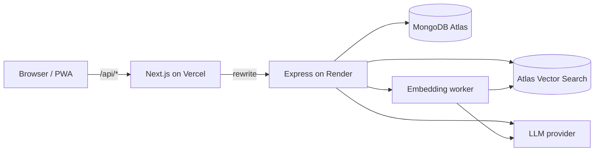

# Architecture: TaskSight

## 1. Stack

| Layer | Choice |
|---|---|
| Web | Next.js 16 (App Router), TypeScript, Tailwind, shadcn/ui, Framer Motion, TanStack Query, dnd-kit, recharts |
| API | Express 5, TypeScript, Mongoose, Zod, Pino + pino-http, helmet, express-rate-limit |
| Auth | Access JWT (15 min, `jose`) and a rotating refresh token in an httpOnly cookie, plus RBAC |
| Database | MongoDB Atlas M0 with Atlas Vector Search |
| LLM | Provider-agnostic `llm/` module. Gemini Flash Lite as the default model, Gemini Embedding 001 at 768 dimensions |
| Jobs | In-process queue for embeddings |
| Quality | Vitest, Supertest, mongodb-memory-server, GitHub Actions |
| Hosting | Vercel (web), Render free tier (API) |

The API is separate from Next.js to support long jobs, streaming and a future mobile client.

## 2. Repo layout (pnpm monorepo)
```
TaskSight/
  apps/
    api/        Express (Lane A)
      src/
        config/env.ts       Zod-validated env
        errors/             AppError, central handler
        routes/ modules/    feature modules
        middleware/         requireAuth, rbac, validate, limiters
        db/                 connection, models
        llm/                provider interface, limiter, cache, prompts
        app.ts              builds the app (no listen)
        server.ts           listens, graceful shutdown
    web/        Next.js (Lane B)
  packages/
    shared/     Zod schemas and types used by api and web
  evals/        cases.jsonl, fixtures/, run.ts, results/
  docs/         prd, architecture, design, rule, task, memory
```

`@tasksight/shared` exports raw TypeScript (`exports: "./src/index.ts"`):
- The API runs it with `tsx` in development.
- The web app lists it in `transpilePackages`.
- The API production build uses `tsup` with `noExternal: ["@tasksight/shared"]`, because `tsc` cannot compile a package outside the API `rootDir`.
- `shared` is isomorphic: no Node built-ins, no Mongoose, no server-only imports.

## 3. Same-origin API
The browser calls `/api/*` on the web origin. Next.js rewrites it to the API.



- Rewrite: `/api/:path*` to `${API_ORIGIN}/:path*`. In development `API_ORIGIN` is `http://localhost:4000`, so dev and prod behave the same.
- The API serves `/auth/*` and `/health` at its own root. Only the browser-facing prefix is `/api`.
- Reason: Safari and Firefox block third-party cookies, so a `SameSite=None` refresh cookie between `*.vercel.app` and `*.onrender.com` is unreliable. With the rewrite the cookie is first-party and can be `SameSite=Lax`.
- API responses send `Cache-Control: no-store`. If Vercel still caches a rewritten response, also send `Vercel-CDN-Cache-Control: no-store`.
- Optional hardening: Vercel adds an `x-origin-secret` header and the API rejects requests without it, so the public Render URL cannot be used directly.
- CORS is an origin allowlist from env, mainly for local tools.
- `TRUST_PROXY_HOPS` env sets Express `trust proxy` to an exact hop count (never `true`). Behind Vercel and Render it is probably 2. Verify at deploy by logging `req.ip` and `x-forwarded-for`.
- Streaming (SSE) through the rewrite needs a spike: no buffering and no early idle timeout. Fallback: stream directly from the API origin with the bearer token, for streaming endpoints only.

## 4. Auth
- **Access token:** 15 minutes, held in memory on the client, never in localStorage. `JWT_ACCESS_SECRET` must be at least 32 characters in production.
- **Refresh token:** random 256-bit value stored as a sha256 hash with a family id, rotated on every refresh. The record keeps `previousTokenHash` and `previousUsedAt`. Lifetime comes from `REFRESH_TOKEN_TTL_DAYS` (default 14). Expired records are pruned on login, refresh, and logout; no more than 10 refresh-token records are retained per user.
- **Cookie:** `refreshToken`, `HttpOnly`, `SameSite=Lax`, `Secure` in production, `Path=/api/auth`.
- **Grace window:** `REFRESH_GRACE_SECONDS` (default 10). Only hashes are stored, so an old token cannot be re-issued. If the presented token is the previous one and was rotated within the window, rotate again in the same family and set a fresh cookie. Otherwise treat it as reuse: revoke the family and return 401. The window is measured between server-side rotation times, so a cold start that delays queued requests does not break it. Two requests that present the same cookie at the same instant can collide on the user document (a Mongoose version conflict). The server retries such a refresh up to 3 times, so the second request takes the grace-window path instead of failing with a 500.
- **Passwords:** Argon2id via `@node-rs/argon2` with explicit parameters (`memoryCost` 19456 KiB, `timeCost` 2, `parallelism` 1). `node-argon2` defaults to 64 MiB per hash, too much for a 512 MB container. A semaphore caps concurrent hashes at 2. Verification dispatches on the hash prefix (`$argon2id$`, `$2a$`, `$2b$`) so another algorithm can be added later. Refresh tokens are never hashed with Argon2.
- **Client refresh (single-flight):**
  - Trigger: a 401 with `code: "UNAUTHORIZED"` on a protected endpoint.
  - One refresh at a time; later 401s attach to the same promise.
  - A 401 from `/auth/refresh`, `/auth/login` or `/auth/register` never triggers a refresh.
  - On success, replay each queued request once. A second 401 redirects to `/login`.
  - On rejection (the refresh call answers 401 or 403): clear the token, clear the TanStack Query cache, and the protected layout redirects to `/login`.
  - Network errors, 429 and 5xx do NOT log the user out. The request fails with a web-only `NETWORK` error and the user can retry (decision D-23). A replay that still returns 401 after a successful refresh also ends the session.
  - After the app loads, call `GET /api/health` before the first refresh to wake the API; show the wake screen if it is slow. The wake screen appears after the first failed check, and a "did not respond" screen with a retry button appears after 90 seconds.
  - Scope is per tab. The server grace window covers simultaneous tabs.

## 5. API contract
Paths are the API's own. The browser uses the same paths behind `/api`.

| Endpoint | Request | Success | Failure |
|---|---|---|---|
| `GET /health` | none | 200 `{status:"ok", uptime, version}`. `version` comes from `APP_VERSION` (default `"0.0.0"`). Exempt from rate limiting | n/a |
| `POST /auth/register` | `{name, email, password}` (password 8 to 128 chars) | 201 `{accessToken, user:{id,name,email}}` plus refresh cookie. Also creates a personal workspace named "My Workspace" with the new user as owner | 400, 409 email exists, 429 |
| `POST /auth/login` | `{email, password}` | 200 same body plus cookie | 401 invalid credentials, 429 |
| `POST /auth/refresh` | cookie only | 200 `{accessToken, user}`, cookie rotated | 401 invalid, or reused outside the grace window |
| `POST /auth/logout` | cookie | 204, cookie cleared | n/a |
| `GET /auth/me` | `Authorization: Bearer` | 200 `{user}` | 401 |
| `GET /workspaces` | `Authorization: Bearer` | 200 `{workspaces:[{id,name,ownerId}]}` | 401 |
| `POST /workspaces` | `{name}` + Bearer | 201 `{workspace:{id,name,ownerId}}` | 400, 401 |
| `GET /workspaces/:workspaceId` | Bearer, any role | 200 `{workspace, members:[{userId,role,name,email}]}` | 401, 403, 404 |
| `POST /workspaces/:workspaceId/members` | `{email, role}` + Bearer, owner | 204 | 400, 401, 403, 404, 409 |
| `PATCH /workspaces/:workspaceId/members/:userId` | `{role}` + Bearer, owner | 204 | 400, 401, 403, 404 |
| `DELETE /workspaces/:workspaceId/members/:userId` | Bearer, owner | 204 | 401, 403, 404 |
| `DELETE /workspaces/:workspaceId/leave` | Bearer, any role | 204 | 401, 403, 404 |
| `GET /workspaces/:workspaceId/tasks` | Bearer, viewer+; query: status, priority, assigneeId, label, dueFrom, dueTo, sort, limit(1-100), cursor | 200 `{items:[Task], nextCursor}` | 400, 401, 403, 404 |
| `POST /workspaces/:workspaceId/tasks` | `{title, ...}` + Bearer, member+ | 201 `{task}` | 400, 401, 403 |
| `GET /workspaces/:workspaceId/tasks/:taskId` | Bearer, viewer+ | 200 `{task}` | 401, 403, 404 |
| `PATCH /workspaces/:workspaceId/tasks/:taskId` | partial + Bearer, member+ | 200 `{task}` | 400, 401, 403, 404 |
| `DELETE /workspaces/:workspaceId/tasks/:taskId` | Bearer, member+ | 204 | 401, 403, 404 |
| `GET /workspaces/:workspaceId/tasks/stats` | Bearer, viewer+; query: `tz` (IANA name, default `UTC`) | 200 `{counts:{todo,in_progress,done}, total, completedByDay:[{date,count}] x7, completedLast7Days}` | 400, 401, 403, 404 |
| `POST /ai/parse-task` | `{text (1 to 500 chars), tz? (IANA zone, default UTC), workspaceId?}` + Bearer | 200 `{task:{title,priority,dueDate (ISO at 12:00 UTC or null),labels[]}, fromSample}` | 400, 401, 403, 429, 500 |
| `GET /ai/usage` | Bearer; query: `days` (1-30, default 7) | 200 `{days, byFeature, total, quota:{limit,usedToday}}`; each metric has calls, failures, cacheHits, samples, tokensIn, tokensOut, estCost and p95LatencyMs. p95 uses nearest-rank over real model attempts, excluding cache/sample and quota/limiter/unavailable fallbacks | 400, 401, 429 |

- **Task stats:** `GET /workspaces/:workspaceId/tasks/stats?tz=Area/City` returns counts by status, the total, and the number of tasks completed on each of the last 7 calendar days in the given time zone (zero-filled, oldest first), plus their sum. The route is registered before `/tasks/:taskId`. An invalid `tz` returns 400.
- **Error shape:** `{ error: { code, message, details? } }`, with `details` as `Array<{ path: string, message: string }>` or omitted.
- **Codes:** `VALIDATION_ERROR` 400, `PAYLOAD_TOO_LARGE` 413, `UNAUTHORIZED` 401, `FORBIDDEN` 403, `NOT_FOUND` 404, `CONFLICT` 409, `RATE_LIMITED` 429, `INTERNAL` 500.
- **User shape:** `{ id, name, email }`. A Mongoose `toJSON` transform maps `_id` to `id` and drops `passwordHash` and `refreshTokens`.
- **Workspace shape:** `{ id, name, ownerId }`. `ownerId` is the User id string. `toJSON` maps `_id` → `id`.
- **Workspace member shape:** `{ userId, role, name, email }`. `role` ∈ `owner | member | viewer`. `name` and `email` are joined from User.
- **Roles:** `owner > member > viewer`. `requireRole(min)` allows `role >= min`. The last owner cannot demote themselves or leave (returns `FORBIDDEN`).
- **Task shape:** `{ id, workspaceId, title, description, status, priority, dueDate, labels[], assigneeId, subtasks[], createdBy, version, embeddingStatus, completedAt, createdAt, updatedAt }`. `status` ∈ `todo | in_progress | done`; `priority` ∈ `low | medium | high`; `dueDate` and `assigneeId` nullable; `subtasks` capped at 30. Every successful task PATCH increments `version` atomically. `completedAt` is an ISO string or null. It is set when a task is created as `done` or moves to `done`, cleared when it leaves `done`, and stays null for tasks that were already done before the field existed.
- **Task pagination:** cursor is base64url JSON `{v, i}` where `v` is the sort value (createdAt or dueDate with null-sentinel) and `i` is the `_id` tiebreak. Sort is 2-key (`sortVal`, `_id`) so pages never duplicate or skip. `null` dueDate sorts last in both directions.
- Later endpoints: tasks (filters, sorting, cursor pagination), `/ai/subtasks`, `/ai/ask` (streaming), `/ai/agent/propose`, `/ai/agent/approve`, and an AI usage summary.

## 6. Request pipeline (Express 5)
Order: pino-http, helmet, cors, `/health`, rate limiter, `express.json({ limit: "100kb" })`, routes, 404 handler, error handler. The limiter sits before body parsing so throttled requests stay cheap. `/auth/*` and `/ai/*` get stricter limiters. Defaults: 600 requests per 15 minutes per IP overall and 300 for `/auth/*`; login and register share a stricter limiter that counts only failed attempts (10 per 15 minutes). `RATE_LIMIT_ENABLED=false` turns every limiter off (local development only). The default in-memory limiter store resets when Render spins down, which is acceptable for one instance.

Validation: a Zod middleware parses `params`, `query` and `body` and stores the result on `req.valid` (typed). Express 5 makes `req.query` a read-only getter, so it is never assigned. Mongoose runs with strict schemas and `sanitizeFilter: true` for NoSQL operator injection.

## 7. Data model

| Collection | Key fields |
|---|---|
| User | name, email (unique), passwordHash, refreshTokens[] (tokenHash, familyId, expiresAt, previousTokenHash, previousUsedAt) |
| Workspace | name, ownerId |
| WorkspaceMember | workspaceId, userId, role (`owner`, `member`, `viewer`) |
| Task | workspaceId, title, description, status, priority, dueDate, labels[], assigneeId, subtasks[] (`{title, done}`, max 30), createdBy, version, embeddingStatus (`clean`, `dirty`), completedAt, timestamps |
| RagChunk | workspaceId, sourceType, sourceId, text, embedding (768 floats), updatedAt |
| AgentProposal | workspaceId, createdBy, actions[], targetVersions, expiresAt, idempotencyKey, status, snapshot |
| AiLog | userId, workspaceId, feature, model, tokensIn, tokensOut, latencyMs, estCost (null when the model has no price), success, cacheHit, fromSample, errorCode. Never stores prompt or response text. workspaceId is nullable |

Indexes: `{workspaceId, status}`, `{workspaceId, dueDate}`, `{workspaceId, completedAt}`, `User.refreshTokens.tokenHash`, `User.refreshTokens.previousTokenHash`, and one vector index on `RagChunk.embedding` with `workspaceId` and `sourceType` as filter fields. MongoDB has no row-level security, so isolation is enforced in code and inside every `$vectorSearch` filter. Subtasks are embedded and capped to avoid unbounded arrays and `$lookup`.

Atlas M0 limits that shape the design: 512 MB storage, 100 operations per second, 500 connections, and at most 3 search and vector indexes combined. A 768-float vector is 3,072 bytes.

## 8. LLM layer and AI features

| Feature | Mechanism |
|---|---|
| Quick-add | Model returns JSON validated with Zod, one retry, confirm chip. On rate limit or parse failure the UI opens a pre-filled manual form |
| Subtasks | Same pattern, array output saved as embedded checklist items |
| Insight | Vector search with workspace and role pre-filter, cited answer, every cited ID validated |
| Agent | Proposals only (section 9) |
| Observability | Each call writes an `AiLog` row. The dashboard shows p95 latency and cost per query |

**`llm/` module:** provider interface, token-bucket limiter, retry with exponential backoff and jitter, response cache keyed by (prompt hash, model), per-user quota, cached sample fallback, logging. No provider SDK is called anywhere else. Model IDs and limits come from env.

**Models:** `gemini-3.1-flash-lite` for text and `gemini-embedding-001` for embeddings (768 dimensions through `outputDimensionality`), both read from env. `gemini-3.5-flash-lite` is the text fallback. `gemini-2.0-flash-lite` is shut down.

**Free-tier limits** (my AI Studio console on 2026-11-13; Google no longer publishes fixed numbers, so re-check in the console):

| Model | RPM | RPD | Use |
|---|---|---|---|
| Flash Lite | 15 | 500 | Default for all features |
| Other Flash | 5 | 20 | Rare spot checks |
| Embedding 001 | 100 | 1,000 | RAG embeddings |
| Gemma 4 | 30 | 14,400 | Bulk eval runs (TPM 16K) |
| Pro | 0 | 0 | Unavailable |

Daily quotas reset at midnight Pacific.

**Embeddings:**
- 768 dimensions (quality is about the same as 3072, with 75% less storage). Normalize vectors in code (L2) for dimensions other than 3072.
- `RETRIEVAL_DOCUMENT` for ingestion and `RETRIEVAL_QUERY` for searches. One model and dimension per index; switching models means re-embedding everything.
- Chunk and embed in the background. A task edit only sets `embeddingStatus: "dirty"` and the worker re-embeds. Saving a task never calls the LLM.
- One `RagChunk` collection with a `sourceType` filter keeps the index count low.
- `embedContent` can return 429 even under quota, so it always uses backoff with jitter.

**Retrieval:** the `workspaceId` and role-based visibility pre-filter is mandatory, so restricted tasks never reach the LLM context. Hybrid keyword + vector retrieval is a later improvement.

**Prompt injection:** task and comment text is untrusted. Use delimiters, never let retrieved text trigger actions, validate outputs with Zod, enforce citations, and require approval for writes.

## 9. Agent safety
Each proposal stores the target document versions (preconditions), a short TTL, a single-use idempotency key, and a snapshot taken before changes for undo and audit. On approval the server re-checks the approver's role and that each target still matches its stored version; a mismatch aborts that action. v1 has two tools: generate subtasks and reschedule overdue tasks.

## 10. Evals
```
evals/cases.jsonl    {id, feature, input, expected}, about 50 cases
evals/fixtures/      recorded model responses
evals/run.ts         runs cases and prints a results table
evals/results/       latest table, committed for the README
```

| Tier | When | Checks |
|---|---|---|
| Replay | Every PR, no API calls | Zod validity of recorded outputs, field accuracy, citation validation, injection fixtures, tool-call schema validation |
| Live | On demand (`pnpm eval:record`) or nightly | Re-records fixtures with real model calls; compares providers for the README table |

Live runs use free-tier quota and vary between runs, so PRs replay recorded responses. Agent runs are graded by the final database state, including checks that unrelated tasks were untouched. Metrics: JSON validity, field accuracy, retrieval hit@k, groundedness, cost and latency. CI fails below per-metric thresholds.

## 11. Testing approach
- API tests use Vitest, Supertest and mongodb-memory-server, with the Mongo binary cached in CI.
- mongodb-memory-server cannot run `$vectorSearch`. Vector queries sit behind a repository interface; CI uses a fake, and real retrieval is tested locally against the dev Atlas cluster or `mongodb-atlas-local` (indexing lags by several seconds after seeding).

## 12. Deployment
- **API (Render):** `render.yaml` defines the service, frozen-lockfile install, API build/start commands and `/health` health check. The start script runs `node dist/server.js`. Enter `MONGODB_URI` and `CORS_ORIGIN` privately in Render; the manifest generates `JWT_ACCESS_SECRET` (at least 32 characters in production). Other settings use the defaults in `apps/api/src/config/env.ts`; set the Gemini key and model values there when enabling live AI calls.
- **Web (Vercel):** `apps/web/vercel.json` identifies the Next.js app. Set `API_ORIGIN` to the Render service origin for the existing rewrite. Set Render's `CORS_ORIGIN` to the Vercel site origin.
- **Proxy:** `render.yaml` initially sets `TRUST_PROXY_HOPS=1`. Inspect the API's `requestIp` and `xForwardedFor` log fields behind the deployed proxy chain, then set the hop count based on observed requests (A-02); do not assume it is 2.
- **Atlas:** allow `0.0.0.0/0` only at deploy time, with a strong password. An idle M0 cluster can pause, so confirm it is active before a demo.

## 13. Implementation notes and deviations (2026-11-28)

- The dashboard chart uses recharts (the plan was hand-written SVG; accepted). Sparklines are hand-written SVG.
- The web client keeps the workspace choice in `localStorage` (`tasksight.workspaceId`), always inside try/catch.
- Every task query key starts with `["tasks", workspaceId]`, so one invalidation refreshes the board and the dashboard.
- The board loads pages of 100 up to 300 tasks, then shows a notice.
- `ApiError.code` can be `NETWORK` (web only, not one of the shared error codes).
- The tsup production build and Render/Vercel configs are implemented and locally validated; a live deployment and `x-origin-secret` remain pending. Other unfinished items include `/ai/*` routes, the `llm/` module, `RagChunk`, `AiLog` and `AgentProposal`.
- Password verification does not yet dispatch on the hash prefix.
- Known gaps are tracked in `docs/issues.md`; ideas that are not built are in `docs/improvements.md`.
- LLM module (`apps/api/src/llm`, task 3.1): every model call goes through `getLlm()`. Order: response cache, per-user daily quota (real calls counted from `AiLog` since midnight US Pacific), per-model limiter (per-minute bucket and a daily count), main model then fallback model, then a saved sample answer. A sample is returned with `fromSample: true` instead of an error. It does not stream yet. Prices are in `llm/pricing.ts`; a model without a price gives `estCost: null`.
- Models: text `gemini-3.1-flash-lite`, fallback `gemini-3.5-flash-lite`, embeddings `gemini-embedding-001` at 768 dimensions (vectors normalized in code). The API starts without `GEMINI_API_KEY`; AI calls then return the sample.
